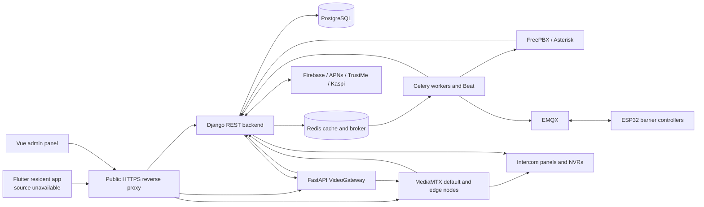

## System landscape

Arrows show logical communication, not public firewall openings. Flutter connectivity is a server-side integration contract; its actual networking implementation is not inspected.
